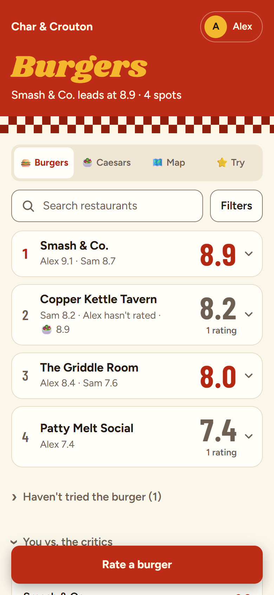
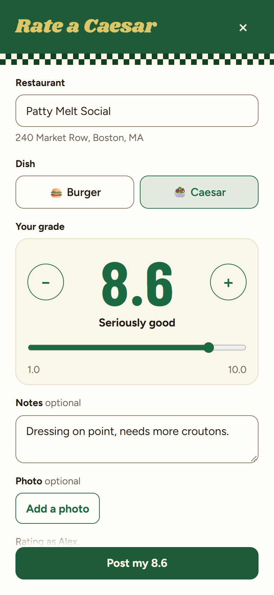
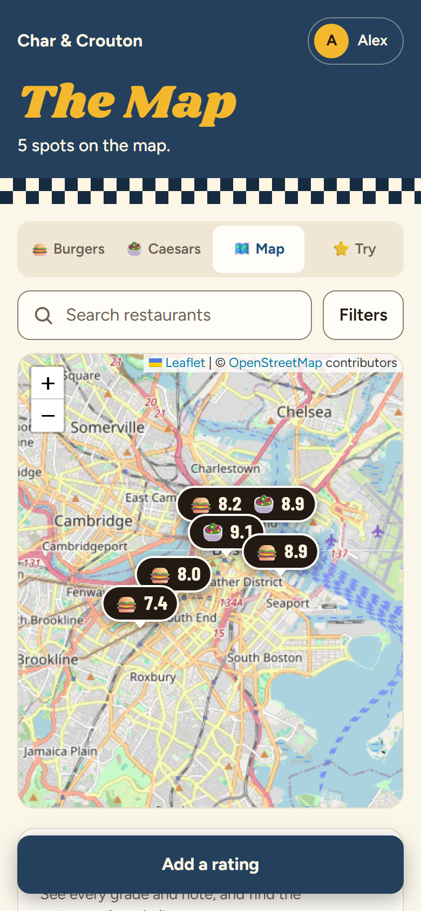
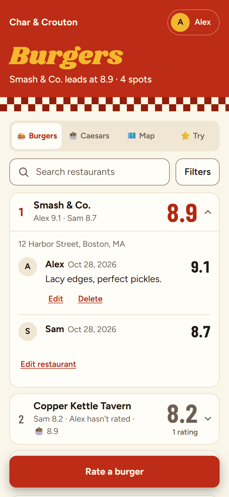
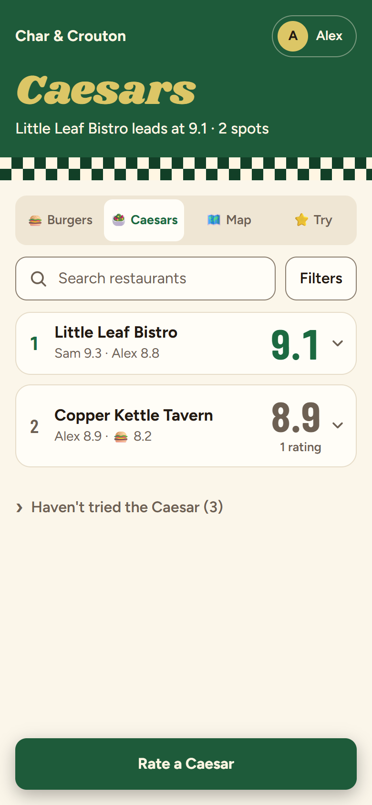

# Char & Crouton

Rate burgers and Caesar salads with your friends, on a 1.0 to 10.0 scale.

<table>
  <tr>
    <td></td>
    <td></td>
    <td></td>
  </tr>
  <tr>
    <td></td>
    <td></td>
    <td></td>
  </tr>
</table>

- **Two boards, one argument:** burgers and Caesars ranked by everyone's average, with each person's grade on the row.
- **Grades in tenths:** big plus and minus buttons for exact scores, starting blank so nobody's nudged toward a number.
- **A shared map:** every restaurant pinned with its scores, plus a want-to-try list and the critics' picks.
- **Private to your group:** invite-only accounts, and it runs free on Cloudflare or on your own computer.

**Want this for tacos and margaritas, or any two foods?** Follow [Make your own version](MAKE-YOUR-OWN.md). The code is free to use under the [MIT license](LICENSE).

Screenshots use made-up people and restaurants from `scripts/demo-data.json`. To retake them, run `node scripts/screenshots.js`.

## Run it

Double-click `start.bat`, or run `node server.js`. It needs [Node.js](https://nodejs.org) 18 or newer and nothing else.

The window that opens lists two addresses: one for this computer and one for friends on the same Wi-Fi. If Windows asks about the firewall, allow access on private networks so they can connect. The app is only available while that window is open.

To check that everything is working and saving correctly, run `npm run check`. It only reads your real data and does its testing on a throwaway copy.

## Accounts

Everyone signs in. To add someone, or reset a forgotten password, run this on the computer running the app and send them the code privately:

```
npm run invite -- Sam
```

The code works once, for 7 days. They choose "I have an invite code", then pick their own password. If the name already has ratings, those ratings become theirs, so only send a code to the right person.

## Burger lists

The critics' lists live in `public/lists.json`. To add or refresh one, edit that file with each restaurant's name and a link to the source. Keep to names and addresses rather than copying reviews.

## Your data

Ratings are saved in `data/ratings.json` and photos in `data/photos`. Back up the `data` folder to back up everything. `data/thumbs` holds small copies of the photos for the board, which the app remakes if they go missing.

Restaurant suggestions come from [Photon](https://photon.komoot.io), a free search over OpenStreetMap, so what you type in the restaurant box is sent there. If it's unavailable, you can still add restaurants by hand. The Map tab uses OpenStreetMap's map images and looks up restaurant websites there, so it needs an internet connection.

## Backups

The app makes a dated copy of your ratings and photos in `data/backups` once a day, keeping the last 14. Run `npm run backup` for one that's kept until you delete it. To restore, stop the app and copy a backup's `ratings.json` and `photos` back into `data`.

## Going online (Cloudflare)

The `worker/` folder is a version of the app for Cloudflare's free plan, with data in Cloudflare's D1 databases instead of a file. It uses the same page, the same sign-in rules and the same owner tools. Stay on the free plan and don't add R2 storage, so nothing can be billed.

One-time setup, run from this folder after creating a free Cloudflare account:

1. Sign in: `npx wrangler login`
2. Create the two databases, and copy each printed `database_id` into `wrangler.jsonc`:

   ```
   npx wrangler d1 create char-and-crouton
   npx wrangler d1 create char-and-crouton-photos
   ```
3. Create the tables:

   ```
   npx wrangler d1 migrations apply char-and-crouton --remote
   npx wrangler d1 migrations apply char-and-crouton-photos --remote
   ```
4. Make an admin token with `node scripts/host.js token`, then store it on Cloudflare with `npx wrangler secret put ADMIN_TOKEN` and paste it when asked. Keep a copy somewhere private.
5. Publish it with `npx wrangler deploy`. It prints the app's `workers.dev` link.
6. Freeze and back up your computer's copy, then upload it:

   ```
   node scripts/freeze.js "We've moved: https://your-link"
   node scripts/backup.js
   node scripts/host.js push
   ```

The upload checks that Cloudflare's copy matches, and it refuses to run if Cloudflare already has data. Passwords set on the home version can't be checked on Cloudflare's free plan, so everyone claims a new invite on the new link (`node scripts/host.js invite Name`) and keeps their name and ratings.

Afterwards, publish updates with `npx wrangler deploy`. When an update adds a file to `worker/migrations` or `worker/migrations-photos`, run the two commands from step 3 first; they only apply what's new. Save a backup to your computer regularly with `node scripts/host.js pull`. Cloudflare also keeps 7 days of restore points. `node scripts/host.js freeze "message"` pauses changes, and `freeze off` resumes them.

`npm run check:worker` runs the Cloudflare version on this computer with a throwaway database and tests everything, without touching Cloudflare or your real data.

On iPhone, install it from Safari with **Share > Add to Home Screen**. On Android, use **Install app** or **Add to Home screen** in Chrome's menu.

## Moving the app

To keep one live copy, run `npm run freeze -- "We've moved: <new link>"` before copying your data. Nobody can change anything from that moment, and everyone sees the message. Undo it with `npm run freeze -- off`.

Local connections aren't encrypted, so only run the app on networks you trust until it's online with https.
